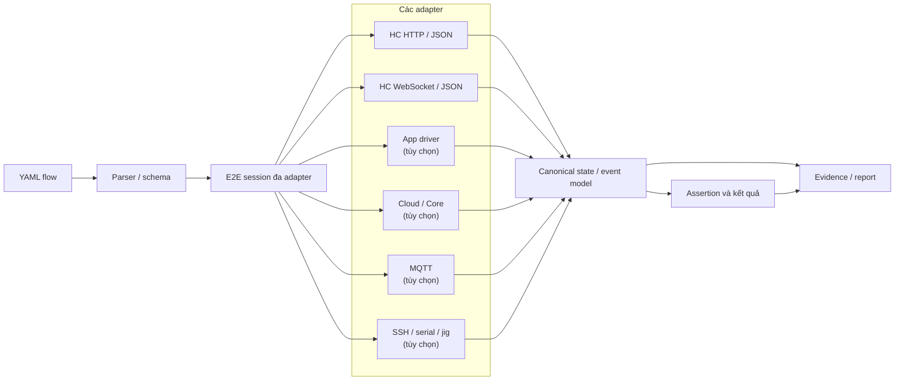
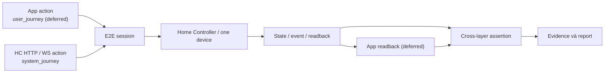
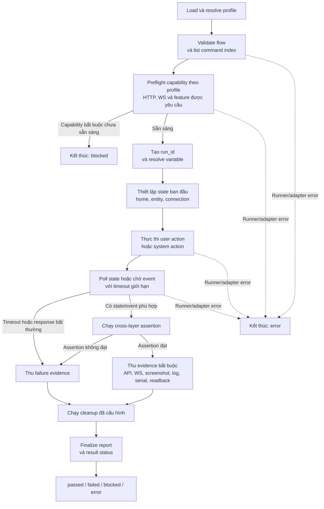
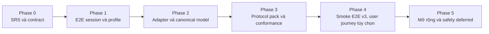

# SRS: Nền tảng E2E tổng quát cho HC trong Lumi Tester

- Trạng thái: Bản nháp v0.2 để review
- Phiên bản: 0.2
- Ngày: 2026-10-14
- Phạm vi: `nl-tester`
- Implementation ưu tiên: `lumi-iot-v3/bin/home-controller`
- Quy trình: không tự động commit, push hoặc tạo PR

## 1. Mục đích

Mở rộng Lumi Tester từ công cụ tự động hóa App và hardware jig thành nền tảng
kiểm thử E2E đầy đủ cho các hệ thống Home Controller (HC).

Nền tảng phải hỗ trợ nhiều implementation HC khác nhau mà không nhúng protocol
của một project cụ thể vào test runner. Implementation đầu tiên được chuẩn hóa
là `lumi-iot-v3/bin/home-controller`; HCG1 và `hc-module` vẫn là các target mở
rộng qua protocol pack, không phải wire contract dùng chung.

Một test semantic phải có thể tái sử dụng khi implementation sử dụng JSON
device/trait legacy, mô hình Cell/Cell Schema, HTTP/WebSocket, topic MQTT khác
nhau hoặc codec khác nhau.

## 2. Mục tiêu

Hệ thống phải:

1. Chạy vertical slice E2E điều khiển một device đơn bằng một format YAML thống
   nhất của Lumi Tester.
2. Phase 1 dùng component/target dispatch; `journey` là metadata legacy/deprecated,
   không bắt buộc và không được dùng để chọn adapter. App readback được hỗ trợ khi
   flow khai báo target App và có adapter/profile phù hợp.
3. Tái sử dụng App driver, selector, wait, retry, snapshot, report, command
   index và event artifact hiện có.
4. Kết nối `lumi-iot-v3` qua HC HTTP/JSON và WebSocket/JSON. App, Cloud,
   MQTT, SSH, serial, hardware-jig, bridge scan và các capability mở rộng không
   phải acceptance gate của Phase 1.
5. Tách ý định kiểm thử semantic khỏi topic, payload, codec, ID và cơ chế xác
   thực của implementation.
6. Hỗ trợ metadata target như chip, firmware và board trong lab profile mà
   không dùng chip làm điều kiện để chọn semantic protocol.
7. Sinh evidence có cấu trúc để xác định layer sản phẩm bị lỗi.
8. Cho phép thêm HC implementation mới bằng protocol pack mà không phải viết
   lại các semantic test case.

## 3. Ngoài phạm vi

Phase 1 không bắt buộc:

- thay thế unit test, component test hoặc service-level test;
- triển khai business logic HC bên trong `nl-tester`;
- bao phủ toàn bộ trait, camera, lock, alarm, OTA hoặc automation;
- dùng safety policy nâng cao làm điều kiện chặn việc chạy test;
- coi contract của HCG1, `hc-module` hoặc `lumi-iot-v3` là contract chung;
- lưu credential production hoặc secret trong repository.

Đối với Phase 1 của `lumi-iot-v3`, user journey/App, automation/rule, scene,
schedule, group control, Cloud, MQTT, SSH, serial, hardware-jig, bridge scan,
config và execute đều deferred. Việc source có route hoặc type cho capability
không biến capability đó thành acceptance gate.

Các cơ chế safety nâng cao như xác nhận thao tác phá hủy, allowlist SSH nghiêm
ngặt và bảo vệ factory reset được defer. Timeout, retry có giới hạn, structured
result và evidence vẫn là yêu cầu bắt buộc.

## 4. Thuật ngữ

### 4.1 Canonical multi-target YAML amendment (2026-10-18)

Canonical YAML may declare peer `app`, `gateway`, and `cloud` components. Legacy
`platform`/`appId` normalizes to App; legacy `platform: lumi_e2e` plus `profile`
normalizes to `gateway`/`lumi_hc`. `journey` is deprecated migration metadata
only and never selects an adapter.

`runFlow.target` accepts `app`, `gateway`, or `cloud`. It may be omitted only for
a single-target root. Recursive validation resolves child paths, rejects missing
or undeclared targets, detects cycles, bounds depth, checks command capability,
and prevents child headers from replacing root-owned drivers or profiles.

One run owns one shared target session. Adapters preflight/open once, nested
flows push and restore target scope, and adapters close once in reverse open
order. The App boundary remains the existing `PlatformDriver`. The gateway
boundary remains the existing Lumi HC HTTP/WebSocket/canonical evidence code,
with HC facts sourced only from `lumi-iot-v3`.

Cloud is deterministic and mock-only in this phase and cannot open a network
connection. Real Cloud attempts and unavailable real HC/device environments are
`Blocked`, never `Passed`. Mock evidence uses `mock_contract` and cannot be
presented as real-runtime evidence.

Run/test-result JSON and JSONL events add target/component, adapter, profile,
result status, evidence tier, session, and correlation metadata. HC control PASS
requires readback of the requested entity/index/value. `Passed`, product
`Failed`, environment `Blocked`, and runner/adapter `Error` remain distinct;
legacy App report shapes remain readable.

Acceptance includes parser/schema, recursive routing/lifecycle, existing App and
HC contract suites, CLI validate/list, and a no-device/no-network fixture that
executes App initial read -> HC control -> HC readback assertion -> App final
assertion in one session. This fixture proves mock contract behavior only; real
HC and real Cloud remain blocked until their environments are supplied.

### 4.2 User journey

User journey/App được giữ để tương thích và mở rộng sau, nhưng không thuộc
vertical slice Phase 1 và không được dùng làm bằng chứng cho task này.

### 4.3 System journey

Trong Phase 1, flow bắt đầu từ HC HTTP hoặc WebSocket và chỉ bao phủ health,
discovery, state của một device, control một device và realtime readback. Bridge,
SSH, serial, Cloud/Core, MQTT, App và các workflow mở rộng là deferred.

### 4.4 Lab profile

File cấu hình mô tả implementation, protocol pack, HC HTTP base URL, WebSocket
URL, capability của Phase 1, metadata target và thư mục evidence. Các field
App/Cloud/MQTT/SSH/serial/hardware-jig nếu giữ trong schema chỉ là phần mở rộng
deferred, không được đưa vào fixture baseline.

### 4.5 Protocol pack

Tập kiến thức có version, dùng để ánh xạ command, state và event semantic sang
wire message của một implementation cụ thể. Protocol pack có thể chứa mapping
khai báo và dùng Rust adapter cho codec, authentication hoặc state machine phức
tạp.

### 4.6 Canonical semantic model

Biểu diễn độc lập với implementation, được dùng trong assertion:

```text
Entity: entity_id, entity_kind, capabilities, state, metadata
CellEntity: cell_id, device_id, cell_model_id, cell_idx, schema, profile
State: entity_id, ref, idx, value, source, timestamp
Event: entity_id, event_type, ref, value, correlation_id?, timestamp
```

Model này không được giả định `device_id`, `cell_id`, endpoint ID, slot index
hoặc tên trait/capability có cùng ý nghĩa trong mọi implementation. Với v3,
`cell_id` là identity chính của Cell, còn capability như `power` chỉ là alias
được protocol pack ánh xạ tới input/state/command cụ thể.

## 5. Ranh giới và kiến trúc hệ thống

Toàn bộ execution platform nằm trong `nl-tester`.

```text
YAML flow
  -> parser/schema
  -> E2E session đa adapter
       -> HC HTTP/JSON adapter
       -> HC WebSocket/JSON adapter
       -> App adapter (tùy chọn)
       -> Cloud adapter (tùy chọn)
       -> MQTT adapter (tùy chọn)
       -> SSH/serial/jig adapter (tùy chọn)
       -> Evidence/report adapter
  -> canonical state/event model
  -> assertion và kết quả
```

### 5.1 Diagram kiến trúc runtime



E2E session quản lý nhiều target handle cùng lúc. Nó ghép App driver hiện tại
với các adapter bổ sung, không thay thế App driver.

Mỗi adapter nên cung cấp các operation khái niệm:

- health/readiness;
- connect/open và close;
- thực thi operation;
- quan sát state hoặc event;
- trả về structured result;
- thu thập evidence có giới hạn;
- trả về nhóm lỗi đã chuẩn hóa.

## 6. Yêu cầu chức năng

### 6.1 Nền tảng E2E

- **FR-E2E-001**: Parser chấp nhận `platform: lumi_e2e`.
- **FR-E2E-002**: Header có thể giữ `journey` để tương thích, nhưng field này là
  deprecated metadata và không chọn adapter; target được chọn từ component model
  và `runFlow.target`.
- **FR-E2E-003**: System journey phải chạy được health, discovery, state,
  single-device control và WebSocket realtime readback.
- **FR-E2E-004**: App action/readback không phải acceptance gate Phase 1; khi mở
  lại phải có contract/profile riêng.
- **FR-E2E-005**: E2E dùng chung parser, command index, evidence và report
  pipeline hiện có; session/adapter HC là nhánh domain riêng.
- **FR-E2E-006**: Các App YAML không phải E2E tiếp tục chạy không thay đổi.

### 6.2 Profile

- **FR-PROFILE-001**: Flow chọn profile mà không nhúng secret trực tiếp.
- **FR-PROFILE-002**: Profile xác định HC implementation và protocol pack.
- **FR-PROFILE-003**: Profile mô tả được chip, board, firmware, build và
  runtime metadata; AI7688/SSD202D chỉ là metadata, không phải protocol branch.
- **FR-PROFILE-004**: Profile khai báo adapter và capability khả dụng.
- **FR-PROFILE-005**: Profile định nghĩa test data và evidence root.
- **FR-PROFILE-006**: Thiếu capability bắt buộc trả về `blocked`, không trả về
  product `failed`.
- **FR-PROFILE-007**: Capability không được khai báo là bắt buộc nếu target
  implementation không cung cấp transport hoặc feature tương ứng.

### 6.3 App và Cloud adapter

- **FR-APP-001**: Tái sử dụng các App command như `launchApp`, `tap`,
  `see`, `inputText`, wait, assertion và screenshot.
- **FR-APP-002**: App action vẫn truy được bằng command index và sinh artifact
  App hiện có.
- **FR-APP-003**: Chỉ nhìn thấy state trên App không đủ làm evidence cho device
  hoặc HC assertion nếu case yêu cầu structured readback ở lower layer.
- **FR-CLOUD-001**: Cung cấp extension boundary cho Cloud với contract operation
  và response có cấu trúc; phase này chỉ có deterministic mock adapter.
- **FR-CLOUD-002**: Mock Cloud hỗ trợ các operation cần cho fixture mà không mở
  network connection hoặc giả lập real-service evidence.
- **FR-CLOUD-003**: Cloud endpoint/authentication chỉ là profile metadata cho
  future adapter; chưa được dùng để kết nối service thật.

### 6.4 HC API và WebSocket adapter

- **FR-HC-001**: Hỗ trợ HC endpoint HTTP/HTTPS và JSON request/response.
- **FR-HC-002**: Authentication có thể là `none` đối với local HC API; nếu
  implementation yêu cầu secure context, signature hoặc certificate thì pack
  phải khai báo cách lấy credential và cách redaction.
- **FR-HC-003**: Phase 1 hỗ trợ health, discovery, state readback và control
  của đúng một device. Config, command, group, scene và bridge scan là deferred.
- **FR-HC-004**: WebSocket hỗ trợ connect, subscribe, receive state/config/event
  readback, CellSnapshot RPC, timeout và bounded reconnect/resubscribe. V3
  không có replay; sau reconnect phải đồng bộ lại bằng HTTP.
- **FR-HC-005**: Giữ raw HTTP/WS evidence và trả state/event đã normalize.
- **FR-HC-006**: V3 pack Phase 1 chỉ mô tả health, device collection,
  `/api/devices/{device_id}/state`,
  `/api/devices/{device_id}/control` và `/ws`. Route collection
  có khác biệt trailing slash giữa source và Postman/docs, phải giữ là open
  question cho tới khi contract test xác nhận.
- **FR-HC-007**: HTTP success, HTTP error `{code,msg}`, WebSocket close/parse
  error và bridge error phải được map về structured result.

### 6.5 MQTT adapter tùy chọn

- **FR-MQTT-001**: Khi profile khai báo MQTT, adapter hỗ trợ connect broker,
  publish, subscribe, wait-for-message, reconnect và resubscribe.
- **FR-MQTT-002**: Topic, direction, QoS, codec và schema lấy từ protocol pack
  hoặc profile đã chọn.
- **FR-MQTT-003**: Hỗ trợ JSON, protobuf, binary, text và codec mở rộng thông
  qua codec interface.
- **FR-MQTT-004**: Ghi nhận topic, QoS, timestamp, raw payload reference,
  decoded payload và normalized result.
- **FR-MQTT-005**: Matching theo request ID nếu có, entity/device/cell ID,
  event type và field do protocol pack định nghĩa.
- **FR-MQTT-006**: MQTT không phải acceptance gate của `lumi-iot-v3` nếu
  profile không khai báo broker capability.

### 6.6 SSH, serial và hardware

- **FR-DIAG-001**: SSH hỗ trợ service status, thu thập log có giới hạn và
  diagnostic do implementation định nghĩa.
- **FR-DIAG-002**: Serial hỗ trợ mở port đã cấu hình, capture có giới hạn,
  match readiness và diagnostic readback. Với v3, đây là transport nội bộ của
  BLE bridge, không phải MQTT replacement trong semantic contract.
- **FR-DIAG-003**: Hardware-jig operation tái sử dụng hardware transport và
  command model hiện có khi phù hợp.
- **FR-DIAG-004**: Reboot, power-cycle và service restart là operation rõ ràng
  với structured result.

### 6.7 Canonical state và event

- **FR-STATE-001**: Adapter trả được cả raw form và normalized form của
  state/event.
- **FR-STATE-002**: Canonical model biểu diễn identity, capability/ref, slot
  index nếu có, value, timestamp, source và correlation nếu wire protocol có.
- **FR-STATE-003**: Phân biệt continuous state/output với one-shot event.
- **FR-STATE-004**: Assertion match được partial state mà không yêu cầu field
  implementation không liên quan.
- **FR-STATE-005**: Mismatch giữa các source được bật trong profile phải chỉ ra
  source liên quan; không yêu cầu source MQTT hoặc App nếu chúng không tồn tại.

## 7. Contract YAML

### 7.1 Header

```yaml
platform: lumi_e2e
journey: user_journey
profile: profiles/lumi-iot-v3-home-controller.yaml
defaultTimeout: 15000
tags:
  - smoke
  - hc
```

Profile chọn lab và protocol pack. Test không lặp lại cấu hình wire-level.

Profile tối thiểu cho implementation v3 có thể có dạng:

```yaml
implementation: lumi_iot_v3_home_controller
protocolPack: lumi_iot_v3_home_controller
target:
  chip: ssd202d
  firmware: "<firmware-version>"
hc:
  baseUrl: <LUMI_V3_BASE_URL>
  websocketUrl: <LUMI_V3_WS_URL>
  auth:
    mode: none
  capabilities:
    - health
    - device_discovery
    - device_state
    - device_control
    - realtime_cell_readback
app:
  enabled: false
cloud:
  enabled: false
mqtt:
  enabled: false
recovery:
  ssh:
    enabled: false
evidenceRoot: ./output
```

Tên field của profile là contract của Lumi Tester; URL, port, chip và
capability phải được thay bằng lab thực tế. `auth.mode: none` là hợp lệ cho
local API v3 hiện tại và không có nghĩa là mọi implementation đều bỏ qua auth.

Capability baseline cho profile v3:

| Capability | Mặc định v3 | Điều kiện |
| --- | --- | --- |
| `health`, `device_discovery`, `device_state`, `device_control` | Bắt buộc | Home Controller HTTP hoạt động |
| `realtime_cell_readback` | Bắt buộc cho realtime smoke | WebSocket hoạt động |
| `app`, `cloud`, `mqtt`, `ssh`, `serial`, `hardware_jig` | Deferred | Không thuộc acceptance gate Phase 1 |
| `group`, `scene`, `schedule`, `automation`, `bridge_scan` | Deferred | Không dùng trong single-device baseline |

### 7.2 App command dùng chung

Các command hiện có tiếp tục hợp lệ khi App target được cấu hình:

```yaml
- launchApp
- tap: "Turn on"
- inputText: "${VALUE}"
- waitUntilVisible: "Home"
- see: "On"
- appRefresh
```

### 7.3 Semantic command Phase 1

```text
hcHealth, hcGetEntities, hcGetState, hcControl, hcWaitState
wsSubscribe, wsExpect, wsRpc
deviceAssertState, captureEvidence
```

Đây là semantic contract. Protocol pack quyết định operation được encode và
transport như thế nào. Với v3, command control phải nhận `device_id` và danh
sách thay đổi `{idx, value}` explicit. Không suy `idx` từ alias như `power`.

Các command sau được ghi nhận nhưng deferred: `cloudRequest`, `hcExecute`,
`hcScanBridge`, `hcGroupControl`, `hcSceneActive`, `mqttPublish`,
`sshServiceStatus`, `serialOpen`, App command, automation/rule, scene và
schedule.

### 7.4 Ví dụ user journey

```yaml
platform: lumi_e2e
journey: user_journey
profile: profiles/lumi-iot-v3-home-controller.yaml
defaultTimeout: 15000
tags: [smoke, control]
---
- launchApp
- tap: "Living room light"
- tap: "Turn on"
- hcWaitState:
    entity: "${CELL_ID}"
    state:
      - idx: 1
        value: true
- appRefresh
- see: "On"
```

Flow này chỉ hợp lệ khi profile có App capability; App action là điểm bắt đầu,
còn HC state readback là evidence chính cho behavior của HC.

### 7.5 Ví dụ system journey Phase 1

```yaml
platform: lumi_e2e
journey: system_journey
profile: profiles/lumi-iot-v3-home-controller.yaml
defaultTimeout: 15000
tags: [smoke, control]
---
- wsSubscribe:
    channels:
      - "cell:${CELL_ID}"
- hcControl:
    device_id: "${DEVICE_ID}"
    changes:
      - idx: "${STATE_IDX}"
        value: true
- wsExpect:
    channel: "cell:${CELL_ID}"
    event:
      type: cell_state_changed
      idx: "${STATE_IDX}"
      value: true
- hcWaitState:
    device_id: "${DEVICE_ID}"
    state:
      - idx: "${STATE_IDX}"
        value: true
```

Trong ví dụ v3, `hcControl` được pack ánh xạ tới
`POST /api/devices/{device_id}/control` với body `[{idx, value}]`; WebSocket
được subscribe trước control để quan sát realtime readback. HTTP `status: true`
chỉ là dispatch result; không được coi là physical/device ACK nếu chưa có state
hoặc event readback.

### 7.6 Diagram hai loại journey



`system_journey` chỉ còn là tên legacy trong các flow cũ. Component declaration
và `runFlow.target` là nguồn định tuyến duy nhất; child header không được thay
driver/profile của parent. Khi flow cần chứng cứ HC, structured HC/WS readback
vẫn là evidence bắt buộc, bất kể App có được dùng hay không.

## 8. Contract của protocol pack

Mỗi pack phải có version và cung cấp các phần sau.

### 8.1 Manifest

```text
implementation_id
protocol_name
protocol_version
pack_version
supported_transports
supported_codecs
supported_capabilities
```

Pack đầu tiên phải có manifest tương đương:

```yaml
implementation_id: lumi_iot_v3_home_controller
protocol_name: lumi-iot-v3-protocol-core
protocol_version: "0.2.0"
pack_version: "0.1.0"
transports:
  - http_json
  - websocket_json
  - serial_diagnostic
authentication:
  mode: none
capabilities:
  - health
  - device_discovery
  - device_state
  - device_control
  - realtime_cell_event
  - group
  - scene
```

`serial_diagnostic`, `group`, `scene` và các capability khác chỉ được bật khi
lab có bridge/feature tương ứng. `mqtt` không nằm trong manifest v3 mặc định.

### 8.2 Entity mapping

Pack ánh xạ implementation identifier về canonical entity, gồm device/trait
legacy, device feature/state, Cell/Cell Schema của v3, endpoint, group, scene
hoặc rule. Các loại ID khác nhau không được coi là có thể thay thế cho nhau.

Với v3, mapping tối thiểu là:

```text
DeviceEntity.id       -> CellEntity.cell_id / device_id
cell_model_id         -> CellEntity.cell_model_id
cell_idx              -> CellEntity.cell_idx
spec.state[idx]       -> canonical state ref
spec.input[idx]       -> canonical control ref
spec.commands[name]   -> canonical command ref
spec.configs[key]     -> canonical config ref
spec.events[name]     -> canonical event ref
```

ID v3 phải được xử lý an toàn như `u64` và có thể xuất hiện dưới dạng chuỗi
thập phân trong JSON; không ép qua số thực của JavaScript.

### 8.3 Semantic mapping

```text
canonical command -> wire command
wire response     -> canonical state
wire event        -> canonical event
```

Ví dụ alias `power` chỉ hợp lệ khi profile/Cell UI hoặc pack khai báo nó trỏ
tới một `input[idx]` và `state[idx]` cụ thể. Semantic test không được tự đoán
`idx` từ tên capability.

### 8.4 Transport và codec mapping

Pack khai báo transport tương ứng với implementation. Với v3, pack khai báo
HTTP route, WebSocket URL/channel/RPC, JSON codec, response/error shape,
authentication mode, reconnect và resubscribe. `topic`, `QoS` và broker chỉ là
field tùy chọn cho pack có MQTT.

V3 WebSocket tối thiểu phải mô tả:

```text
GET /ws?clientId=<id>
subscribe ["device_manager"]
subscribe ["cell:<cell_id>"]
cell_runtime_data -> cell_state_changed | cell_config_changed | cell_event
RPC CellSnapshot -> state vector
```

### 8.5 Error mapping

Lỗi riêng của implementation được map về các nhóm:

```text
not_connected | timeout | unauthorized | invalid_payload
unsupported_capability | device_offline | protocol_error | hardware_error
http_error | websocket_closed | bridge_error | assertion_mismatch
```

HTTP response thành công và HTTP error phải được lưu raw. V3 error body dạng
`{code, msg}` được map về `http_error`, `bridge_error`, `protocol_error` hoặc
nhóm phù hợp theo status/code.

### 8.6 Conformance test

Mỗi pack phải có test theo capability đã khai báo: health, discovery, command
encode/decode, state readback, event matching, reconnect/resubscribe, invalid
payload và evidence redaction. Authentication failure chỉ bắt buộc nếu pack
không khai báo `authentication.mode: none`; MQTT conformance chỉ bắt buộc cho
pack có MQTT capability.

Semantic E2E test chưa được coi là runnable với pack cho đến khi các conformance
test bắt buộc pass; nếu chưa đạt thì run có trạng thái `blocked`.

## 9. Xử lý message

### 9.1 Pipeline message đi vào

```text
transport packet
  -> raw envelope
  -> chọn protocol pack
  -> decode bằng codec đã cấu hình
  -> validate schema nếu có
  -> lấy identity và correlation
  -> normalize thành state/event
  -> match assertion
  -> lưu raw và normalized evidence
```

Với v3, `transport packet` có thể là HTTP JSON response, WebSocket JSON frame
hoặc serial diagnostic record. Không được giả định packet là MQTT message.

### 9.2 Pipeline command đi ra

```text
semantic command
  -> resolve entity/capability
  -> mapping qua protocol pack
  -> validate value/schema
  -> encode payload
  -> render HTTP route hoặc WS request
  -> request/subscribe/publish tùy transport
  -> correlate response/event nếu có
  -> lưu evidence
```

Raw message command có thể được cung cấp để phát triển và chẩn đoán protocol
pack, nhưng product E2E test có khả năng tái sử dụng nên dùng semantic command.

Nếu implementation không cung cấp correlation cho control, runner phải kết luận
qua HTTP result kết hợp state/event readback, entity/cell identity, slot/value
và time window. Runner không được tự tạo correlation giả để biến một dispatch
thành bằng chứng thiết bị vật lý đã áp dụng lệnh.

### 9.3 Diagram xử lý command, message và state

```mermaid
flowchart LR
    command["Semantic command"] --> resolve["Resolve entity / capability"]
    resolve --> mapping["Protocol pack mapping"]
    mapping --> encode["Validate và encode payload"]
    encode --> transport["HTTP request / WS subscribe / MQTT tùy chọn"]

    transport --> raw["Raw response / event"]
    raw --> decode["Decode raw envelope bằng codec"]
    decode --> validate["Validate schema và correlation nếu có"]
    validate --> normalized["Canonical state / event"]
    normalized --> assertion["Match assertion"]
    normalized --> evidence["Lưu raw và normalized evidence"]
    assertion --> evidence
```



## 10. Vòng đời thực thi

Mỗi E2E run phải:

1. Load và resolve profile.
2. Validate flow và list command index.
3. Preflight chỉ các capability mà case yêu cầu và profile khai báo. Với v3,
   tối thiểu kiểm tra HTTP health và WebSocket nếu case cần realtime.
4. Sinh `run_id` duy nhất và resolve variable.
5. Thiết lập state ban đầu của home, entity và kết nối.
6. Thực thi user action hoặc system action.
7. Poll state hoặc chờ event với timeout có giới hạn.
8. Chạy cross-layer assertion.
9. Thu API result, WebSocket frame, screenshot, log, serial output và
   normalized readback theo source được case yêu cầu.
10. Chạy cleanup đã cấu hình.
11. Finalize report và result status.

### 10.1 Diagram vòng đời E2E



Quy tắc kết quả chính:

- `blocked`: preflight hoặc môi trường chưa sẵn sàng, chưa đánh giá được
  behavior của product;
- `failed`: product behavior hoặc assertion bắt buộc không đúng;
- `error`: runner hoặc adapter lỗi khiến không thể kết luận đáng tin cậy;
- `passed`: action, assertion và evidence bắt buộc đều hoàn tất.

`validate`, `list`, `doctor`, `run`, chọn command index, report, snapshot
và events hiện có vẫn là nền tảng. E2E bổ sung preflight theo profile và
multi-adapter session.

## 11. Result status

- `passed`: action, assertion và evidence bắt buộc đều hoàn tất;
- `failed`: product behavior hoặc assertion bắt buộc không đúng;
- `blocked`: environment, adapter, capability, device hoặc pack bắt buộc
  chưa sẵn sàng;
- `error`: lỗi runner hoặc adapter khiến không thể kết luận đáng tin cậy.

`blocked` không được tính là product pass hoặc product fail.

## 12. Smoke coverage Phase 1

Với profile `lumi_iot_v3_home_controller`, HC target là baseline khi flow khai
báo gateway. `journey` không tạo thêm testcase và không ảnh hưởng routing; không
nhân đôi testcase chỉ vì App không thuộc target HC.

Smoke baseline v3:

1. HTTP health/liveness qua `GET /api/health_check`.
2. Device discovery qua `GET /api/devices`; nếu có bridge thì scan, nhận
   `device_added` và xác nhận lại danh sách.
3. Cell state readback qua `GET /api/devices/{device_id}/state`.
4. Device control roundtrip qua `/control`, sau đó đọc state theo `idx/value`.
5. WebSocket subscribe `device_manager` và `cell:{cell_id}`; kiểm tra state,
   config hoặc event realtime khi capability có.
6. Group create/list/state/control/retry khi profile có capability `group`.
7. Scene create/list/active/retry khi profile có capability `scene`.
8. HTTP retry và WebSocket reconnect/resubscribe.
9. HC process restart/recovery qua SSH hoặc service supervisor nếu profile có
   capability `process_recovery`.
10. BLE serial/bridge recovery và network loss chỉ chạy khi lab khai báo
    hardware/diagnostic capability tương ứng.

MQTT reconnect/resubscribe là smoke riêng của pack có MQTT, không phải smoke
bắt buộc của v3. Hub activation X.509 và device onboarding qua bridge là hai
nhóm test riêng; chỉ đưa vào Phase 1 nếu product build/lab cung cấp endpoint và
test fixture tương ứng.

Feature target ban đầu của v3 gồm một Device Cell actuator, một read-only Cell
nếu schema có, một group, một scene, một HC thật và virtual/BLE bridge tùy lab.
Chip AI7688 hoặc SSD202D chỉ được ghi trong metadata profile nếu target deploy
thực tế xác nhận.

## 13. Evidence và reporting

Artifact core bắt buộc:

- `run.json`;
- `events.jsonl` khi được bật;
- report JSON/HTML/JUnit khi được yêu cầu;
- status, duration, retry count và error category của từng command;
- profile name, protocol pack identity, target metadata và `run_id`;
- correlation reference nếu wire protocol có.

Artifact HC/product có thể gồm App screenshot/UI hierarchy, Cloud/Core response,
HTTP request/response, WebSocket frame/RPC, MQTT topic và decoded payload khi có,
SSH log, serial output, jig result và raw/normalized state hoặc event readback.

Secret redaction bắt buộc với example được lưu trong repository và nên áp dụng
cho runtime artifact có khả năng chứa credential hoặc token. Chính sách
evidence safety nâng cao được defer.

## 14. Yêu cầu reliability

Runner phải cung cấp timeout theo command, retry có giới hạn, polling cho
eventual consistency, HTTP retry, WebSocket reconnect/resubscribe, MQTT
reconnect/resubscribe khi được hỗ trợ, SSH/serial reconnect khi được hỗ trợ,
graceful cancellation, command index xác định, rerun theo command index/name và
failure artifact có cấu trúc.

Khi đã có structured readback, generic text log không được là bằng chứng duy
nhất cho semantic state assertion.

## 15. Phạm vi safety được defer

Các nội dung sau không phải acceptance gate của Phase 1:

- bắt buộc SSH command allowlist;
- bắt buộc MQTT topic allowlist;
- confirmation riêng cho reboot hoặc power-cycle;
- factory-reset protection;
- tự động chặn production environment;
- workflow phê duyệt destructive operation.

Các nội dung này có thể được bổ sung sau dưới dạng safety profile.

## 16. Mục tiêu tương thích

### `lumi-iot-v3/bin/home-controller`

Đây là implementation ưu tiên của SRS v0.2. Pack phải mô tả:

- HTTP JSON tại `/api/health_check`, `/api/devices`, `/api/bridges`,
  `/api/groups` và `/api/scenes`;
- WebSocket JSON tại `/ws`, channel `device_manager`, channel `cell:<cell_id>`
  và RPC `CellSnapshot`;
- Protocol Core v0.2: Cell, Cell Schema, input, state, output, event, command,
  config, `At0micCellId`, `At0micIdx` và `At0micDataValue`;
- mapping `DeviceEntity`/Cell/slot về canonical model;
- bridge BLE/virtual và serial diagnostic khi profile bật;
- HTTP error `{code,msg}`, WebSocket close/parse error và bridge error.

Home Controller v3 không được giả định có MQTT. MQTT, Cloud, App và hub
activation là capability ngoài pack mặc định.

Contract route tối thiểu của v3:

| Semantic operation | V3 wire operation | Kết quả cần normalize |
| --- | --- | --- |
| `health` | `GET /api/health_check` | `{status: bool}` |
| `hcGetEntities` | `GET /api/devices` | danh sách `DeviceEntity`/Cell |
| `hcGetState` | `GET /api/devices/{device_id}/state` | state vector theo `idx` |
| `hcControl` | `POST /api/devices/{device_id}/control` | `[{idx, value}]` và readback |
| `hcRequest` config/command | `POST .../config` hoặc `POST .../execute` | status và readback/event |
| `hcGroupControl` | `POST /api/groups/{group_id}/control` | group state/readback |
| `hcSceneActive` | `POST /api/scenes/{scene_id}/active` | scene status/readback |
| `hcScanBridge` | `POST /api/bridges/{protocol}/start_scan` | duration và WS device event |

### HCG1 và `hc-module` legacy

Hỗ trợ thông qua pack mô tả HTTP/HTTPS, WebSocket, MQTT, JSON,
device/trait hoặc feature/state và secure context khi product contract cung cấp.

Đây là mục tiêu tương thích, không phải wire contract hard-code. Mỗi pack phải
cung cấp schema, mapping, transport, correlation policy và authentication thực
tế của implementation đó.

## 17. Tiêu chí nghiệm thu

Implementation được nghiệm thu khi:

1. App-only YAML hiện có vẫn chạy.
2. Flow `platform: lumi_e2e` validate và list được.
3. Legacy HC YAML và canonical gateway YAML được validate/list đúng; môi trường
   HC thật thiếu phải trả `blocked`, không được báo `passed`.
4. Một parent flow có thể route App, gateway và Cloud qua `runFlow.target` trong
   cùng shared session; child header không đổi driver.
5. App, Cloud, HC HTTP/WS, MQTT tùy chọn, SSH/serial và jig có adapter boundary
   rõ ràng.
6. Semantic control/state flow chạy được mà YAML không chứa topic hoặc payload
   cố định của implementation.
7. Một semantic flow có thể chọn các protocol pack khác nhau.
8. V3 `cell_id`, `cell_model_id`, `cell_idx`, slot state và event map được về
   canonical model.
9. Có raw và normalized HTTP/WS evidence; MQTT evidence chỉ yêu cầu khi pack
   có MQTT capability.
10. Smoke coverage v3 tồn tại theo capability matrix.
11. Result phân biệt `passed`, `failed`, `blocked` và `error`.
12. Protocol pack mới có thể pass conformance test mà không sửa semantic case.
13. Workflow không có thao tác tự động commit, push hoặc tạo PR.

## 18. Thứ tự triển khai sau khi SRS được duyệt

1. Thêm parser/header/schema cho component declarations, target và profile; giữ
   `lumi_e2e`/`journey` như legacy compatibility.
2. Tạo multi-adapter E2E session, giữ nguyên App executor và cho App optional.
3. Thêm profile loading, capability matrix, preflight và result category.
4. Thêm HTTP/JSON adapter cho health, device, bridge, group và scene.
5. Thêm WebSocket/JSON adapter cho subscribe, event, RPC và reconnect.
6. Thêm canonical Cell/slot/state/event model và correlation policy optional.
7. Thêm `lumi_iot_v3_home_controller` pack cùng conformance test.
8. Thêm smoke suite v3 theo system journey và capability matrix.
9. Thêm SSH/serial recovery, App/Cloud adapter và MQTT adapter khi có target
   implementation cần chúng.
10. Thêm legacy protocol pack và safety deferred theo phase riêng.

### 18.1 Roadmap theo phase



Mỗi phase cung cấp contract hoặc capability cần thiết cho phase kế tiếp. Phase
2 và Phase 3 giữ engine tổng quát; v3 là vertical slice đầu tiên. Khác biệt
giữa HCG1, `hc-module` và v3 nằm trong adapter và protocol pack tương ứng.

## 19. Project tham chiếu

Các project local sau chỉ được dùng làm tài liệu tham chiếu:

- `D:\lumi-iot-v3\bin\home-controller`
- `D:\lumi-iot-v3\protocol\docs\core-spec\v0.2.0`
- `D:\lumi-iot-v3\docs\protocols\realtime-websocket.md`
- `D:\lumi-iot-v3\docs\protocols\device-activator.md`
- `D:\lumi-iot-v3\AGENTS.md`

SRS này giữ engine semantic tổng quát, nhưng cho phép protocol pack v3 mô tả
chính xác HTTP route, WebSocket channel, Cell/slot mapping và error shape của
`lumi-iot-v3`. Các chi tiết đó không được đưa vào semantic contract dùng chung.

## Binding multi-target decisions (2026-10-18)

This section is normative where earlier draft wording conflicts with the current
implementation scope:

- `app`, `gateway`, and `cloud` are peer components. Legacy `platform`/`appId`
  still normalize to `app`; legacy `platform: lumi_e2e` still normalizes to the
  HC gateway for compatibility.
- `journey` is optional deprecated metadata. It never selects an adapter,
  changes a target, or makes a field mandatory. Routing is determined only by
  normalized components and explicit `runFlow.target` when the root has more
  than one component.
- A child YAML header cannot replace the parent-owned adapter, profile, or
  session. A list-only child is interpreted in the active parent target scope.
- Cloud is an extension boundary with a deterministic mock only. No real Cloud
  network/service integration is part of this SRS revision.
- HC implementation facts may be taken only from `D:\lumi-iot-v3`. Missing real
  HC/device environment is `blocked`; it is never a simulated `passed` result.
- The mock fixture and its `mock_contract` evidence prove routing, lifecycle,
  readback, and reporting behavior only. Real-device evidence requires a fresh
  run against a real lab and must be reported separately.
