# HC Agent and CLI Guide Implementation Plan

> **For agentic workers:** REQUIRED SUB-SKILL: Use superpowers:subagent-driven-development (recommended) or superpowers:executing-plans to implement this plan task-by-task. Steps use checkbox (`- [ ]`) syntax for tracking.

**Goal:** Create one Vietnamese guide that explains how users submit HC test intent to AI agents, how the two Lumi skills collaborate, how developers run an existing HC test library from the CLI, and how the HC boundary can be extended in the future.

**Architecture:** Add a documentation entry point at `lumi-tester/docs/hc-agent-cli-guide.md`. The guide will contain a Mermaid flow diagram, two role-based paths, concrete input-to-output examples, safety/evidence rules, CLI commands, and links to the existing detailed HC/orchestrator/adapter references. It will describe current behavior without adding unsupported runtime claims.

**Tech Stack:** Markdown, Mermaid, Lumi Tester Rust CLI, canonical HC YAML, orchestrator plan CLI, `lumi_agent.py` helper.

---

### Task 1: Create the unified HC guide structure

**Files:**
- Create: `lumi-tester/docs/hc-agent-cli-guide.md`

- [ ] **Step 1: Add the document scope and audience section**

State that the guide serves two audiences: users who provide natural-language test intent to an AI agent, and developers who already have test-case YAML/library and need to run HC tests with the CLI. Explicitly distinguish `lumi-test-orchestrator` as the planning/aggregation layer from `lumi-tester-agent` as the Lumi YAML/execution layer.

- [ ] **Step 2: Add the current architecture diagram**

Use a Mermaid flowchart showing:

```mermaid
flowchart LR
    U[User test request] --> O[Intake + semantic plan\nlumi-test-orchestrator]
    O --> P[Plan validation\nplan validate --for-run]
    P --> A[Delegated HC preflight\nlumi-tester-agent]
    A --> D[hcHealth + discovery + state]
    D --> M[Capability and index mapping]
    M --> G{Mutation authorized?}
    G -- No --> B[blocked / not ready]
    G -- Yes --> Y[Materialize canonical HC YAML]
    Y --> V[validate + list]
    V --> R[run with report/events]
    R --> E[run.json + test-results.json\n+raw/normalized evidence]
    E --> X[validate-delegation + aggregate]
    X --> F[Technical result + business coverage]
```



Include a note that the orchestrator never calls HC directly and that HC readiness uses `hcHealth`, not `doctor --platform lumi_hc`.

- [ ] **Step 3: Add a navigation table**

Link the reader to the user-agent flow, developer CLI flow, skill usage, examples, troubleshooting, and future extension sections.

### Task 2: Document the user-to-agent workflow

**Files:**
- Modify: `lumi-tester/docs/hc-agent-cli-guide.md`

- [ ] **Step 1: Add a natural-language input example**

Use a Vietnamese request that includes HC host, real-device permission, target scope, capability scope, repetitions, execution mode, delay, timeout, restoration, and evidence requirements. Also show a deliberately incomplete request and explain that the orchestrator must return an intake table instead of guessing missing policy.

- [ ] **Step 2: Add the mandatory intake record**

Document the fields for scope, connection, real-device permission, target selection, capabilities, repeat semantics, execution mode, delay, timeout, restoration, and evidence. Show the normalized connection shape with separate `scheme`, `host`, `port`, `profile`, and `status` fields.

- [ ] **Step 3: Add the post-input lifecycle**

Describe these stages in order: classify scope, perform read-only HC preflight, discover live entities, map input/state indexes, design target-dependent scenarios, gate mutation, delegate YAML authoring, validate/list/run, aggregate evidence, and close with restoration status.

- [ ] **Step 4: Add the handoff plan example**

Include a shortened but valid-looking YAML plan with `schemaVersion`, `scope`, `target.connection`, `authorization`, `inventory`, `execution`, `failurePolicy`, `targets`, `acceptance`, and `evidence`. Explain that this plan is not executable Lumi YAML; the tester agent materializes the canonical `header --- commands` flow.

- [ ] **Step 5: Add result semantics**

Explain technical checks versus requested target-dependent scenarios and the meanings of `passed`, `failed`, `blocked`, `skipped`, `error`, and `not_run`. Include the no-eligible-target case and the rule that an HTTP success alone is not physical-control success.

### Task 3: Document how to use both skills

**Files:**
- Modify: `lumi-tester/docs/hc-agent-cli-guide.md`

- [ ] **Step 1: Add the orchestrator usage recipe**

Show a sample instruction to the orchestrator and its expected responsibilities: intake gate, discovery delegation, capability classification, scenario policy, plan validation, delegation, aggregation, and restoration/reporting. State that it must not invent command names, call HC directly, or silently approve real-device mutation.

- [ ] **Step 2: Add the tester-agent usage recipe**

Show a sample delegation prompt containing the approved plan and output directory. List the agent responsibilities: read HC execution references, create/reuse capability templates, materialize typed literal values, validate, list indexes, run with artifacts, inspect failures, and rerun only safe failing commands.

- [ ] **Step 3: Add helper and MCP alternatives**

Document the preferred MCP tool order when configured and the repo-local `lumi_agent.py` commands when MCP is unavailable, including `agent-hc-preflight`, `agent-check`, `agent-run`, and `agent-debug`. Keep real credentials and endpoints in environment variables.

### Task 4: Document the developer CLI workflow and examples

**Files:**
- Modify: `lumi-tester/docs/hc-agent-cli-guide.md`

- [ ] **Step 1: Add prerequisites and endpoint setup**

Show a profile reference using `${LUMI_HC_URL}` and `${LUMI_HC_WS_URL}`, PowerShell environment setup, and a connectivity check. Explain that the profile endpoint points to the HC host, not the machine running Lumi Tester.

- [ ] **Step 2: Add a canonical read-only preflight flow**

Provide an `hcHealth`/`hcGetEntities`/optional `hcGetState` YAML example and the `agent-hc-preflight` command. State that preflight rejects `hcControl` and should be run before any mutation.

- [ ] **Step 3: Add a canonical control/readback/restore flow**

Provide a compact flow using `hcHealth`, `hcGetEntities`, `hcGetState`, `hcControl`, and `hcWaitState`, with entity IDs as quoted strings and explicit indexes. Explain that the actual control and readback mappings must come from live discovery/profile data, not device name or list position.

- [ ] **Step 4: Add the CLI command sequence**

Include exact PowerShell commands from repository root for `validate --json`, `list --json`, `run --platform lumi_hc --report --snapshot --events-jsonl --output`, `--repeat`, and `--command-index`. Include the orchestrator commands for plan validation, delegation validation, and aggregation.

- [ ] **Step 5: Add artifact-reading and debugging guidance**

Explain what to inspect in `run.json`, `test-results.json`, `events.jsonl`, and profile evidence. Include a failure table for connection, unresolved environment, missing capability, mapping/readback mismatch, and missing profile. Explicitly warn not to blindly rerun a mutating control POST after an unknown timeout.

### Task 5: Document future extension boundaries

**Files:**
- Modify: `lumi-tester/docs/hc-agent-cli-guide.md`

- [ ] **Step 1: Add App → Cloud → HC extension flow**

Show the stage sequence `App action → Cloud request/ack → HC dispatch → HC readback → App observation`, identify current Cloud mock/mixed-evidence limits, and explain which stage evidence must be preserved.

- [ ] **Step 2: Add backend/protocol-pack extension flow**

Describe the protocol-neutral `lumi_hc` facade, profile identity tuple (`implementation`, `protocolPack`, `protocolVersion`, `packVersion`), backend lifecycle (`preflight`, `open`, `execute`, `close`), and the fact that adding a backend should not require parser grammar or runner-dispatch changes.

- [ ] **Step 3: Add capability and command extension rules**

Explain how future capabilities, realtime actions, automation rules, and new evidence fields should remain explicit semantic commands and profile capabilities. State that illustrative future commands such as rule creation require parser/backend support before they can be used.

- [ ] **Step 4: Add a phased roadmap table**

Cover immediate reuse of profiles/templates, multi-target/repeated runs, App→Cloud→HC correlation, new HC protocol packs, and richer latency/evidence aggregation. Tie each phase to the stable contracts that must remain unchanged.

### Task 6: Verify and finish the documentation

**Files:**
- Modify: `lumi-tester/docs/README.md` if the documentation index has a suitable link section.
- Modify: `lumi-tester/docs/ai-skills-integration.md` only if a direct link to the unified HC guide is needed.

- [ ] **Step 1: Self-review the guide against the requirements**

Check that both audiences, the post-input flow, diagram, examples, both skills, CLI execution, evidence, safety, and future extension are all present. Remove duplicated low-level material and keep links to the existing reference documents.

- [ ] **Step 2: Check Markdown structure and links**

Run a repository-local search for the new filename and inspect all relative links. Use a Markdown parser/checker if one is already available; otherwise verify headings, fenced code blocks, Mermaid syntax, and shell snippets manually.

- [ ] **Step 3: Run documentation-adjacent verification**

Run:

```powershell
cargo run --manifest-path .\lumi-tester\Cargo.toml -- plan schema --json
cargo run --manifest-path .\lumi-tester\Cargo.toml -- schema --json
```

These commands confirm the examples are aligned with the currently bundled plan and Lumi schemas; do not claim a real HC run unless a gateway is available.

- [ ] **Step 4: Review the final diff**

Run `git diff --check` and inspect the final diff for accidental changes outside the documentation files.

## Self-review

- Requirement coverage: Tasks 1–2 cover the unified architecture and user input-to-agent lifecycle; Tasks 3–4 cover both skills and the developer CLI; Task 5 covers future expansion; Task 6 covers verification and discoverability.
- Placeholder scan: No `TBD` or unbounded implementation steps are used; all documentation sections name their concrete content.
- Scope: The plan changes documentation and optional documentation indexes only; it does not introduce a new runtime feature or unsupported HC protocol.
- Consistency: The plan preserves the repo's existing distinction between `lumi-test-orchestrator`, `lumi-tester-agent`, `hcHealth` preflight, canonical YAML, and the Rust plan contract.
