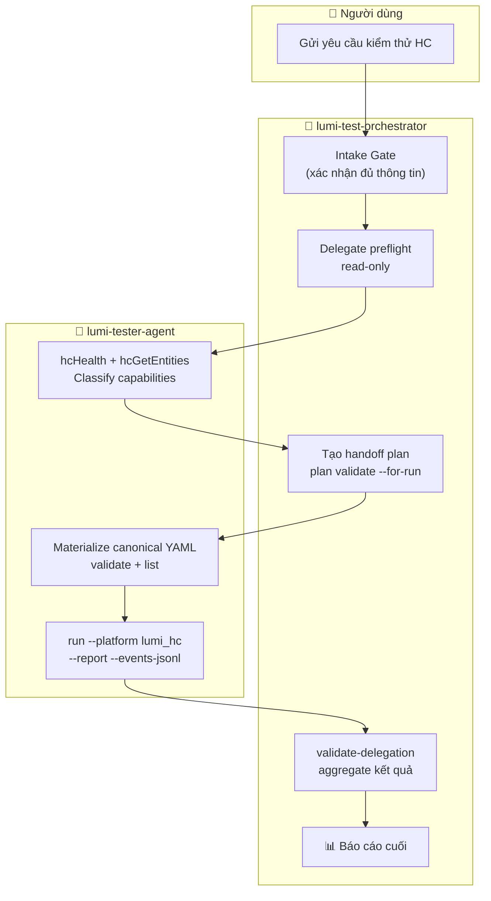
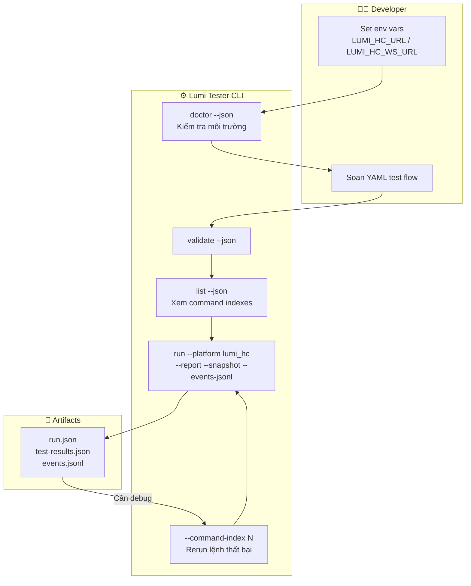

# Hướng dẫn HC Agent & CLI (HC Agent and CLI Guide)

> **Phiên bản:** v1 – HC-only scope.
> **Ngôn ngữ:** Tiếng Việt (kỹ thuật bằng tiếng Anh).

---

## Phạm vi và Đối tượng

Tài liệu này phục vụ **hai đối tượng**:

1. **Người dùng / PM / QA** – Gửi yêu cầu kiểm thử bằng ngôn ngữ tự nhiên cho AI agent và cần hiểu AI sẽ làm gì, hỏi gì, và trả về gì.
2. **Developer** – Đã có thư viện test-case YAML và cần chạy HC test trực tiếp từ CLI Rust mà không cần AI.

**Phân biệt hai skill quan trọng:**

| Skill | Vai trò |
|---|---|
| `lumi-test-orchestrator` | Lớp lập kế hoạch & tổng hợp: nhận yêu cầu, intake gate, điều phối, tổng hợp kết quả |
| `lumi-tester-agent` | Lớp thực thi: soạn YAML canonical, `validate` / `list` / `run`, đọc evidence |

Orchestrator **không bao giờ** gọi HC trực tiếp. Tester-agent **không tự quyết định** chính sách kiểm thử.

---

## Mục lục

| # | Phần | Dành cho |
|---|---|---|
| 1 | [Kiến trúc hiện tại](#1-kiến-trúc-hiện-tại) | Cả hai |
| 2 | [Luồng người dùng → AI agent](#2-luồng-người-dùng--ai-agent) | Người dùng |
| 3 | [Cách dùng hai skill](#3-cách-dùng-hai-skill) | AI agent / developer |
| 4 | [Developer CLI workflow](#4-developer-cli-workflow) | Developer |
| 5 | [Mở rộng trong tương lai](#5-mở-rộng-trong-tương-lai) | Tất cả |

---

## 1. Kiến trúc hiện tại

```mermaid
flowchart LR
    U[User test request] --> O["Intake + semantic plan\nlumi-test-orchestrator"]
    O --> P["Plan validation\nplan validate --for-run"]
    P --> A["Delegated HC preflight\nlumi-tester-agent"]
    A --> D["hcHealth + discovery + state"]
    D --> M["Capability and index mapping"]
    M --> G{Mutation authorized?}
    G -- No --> B["blocked / not ready"]
    G -- Yes --> Y["Materialize canonical HC YAML"]
    Y --> V["validate + list"]
    V --> R["run with report/events"]
    R --> E["run.json + test-results.json\n+raw/normalized evidence"]
    E --> X["validate-delegation + aggregate"]
    X --> F["Technical result + business coverage"]
```



> **Lưu ý kiến trúc:**
> - Orchestrator **không gọi HC** trực tiếp. Mọi tương tác HC đều qua Lumi YAML flow do `lumi-tester-agent` materialized.
> - Kiểm tra sức khỏe HC dùng lệnh `hcHealth`, **không phải** `doctor --platform lumi_hc`.
> - `doctor` kiểm tra môi trường dev (ADB, Appium, Node…); `hcHealth` kiểm tra gateway HC thật.

---

## 2. Luồng người dùng → AI agent



> **Ghi chú:** Mỗi vòng lặp quay lại người dùng chỉ xảy ra khi intake thiếu thông tin.
> Sau khi intake hoàn tất, toàn bộ pipeline chạy tự động đến báo cáo cuối.

### 2.1 Ví dụ yêu cầu đầy đủ

```text
Chạy HC standalone test tại gateway 10.10.61.237:8080,
profile: profiles/lumi-iot-v3.yaml.
Cho phép điều khiển thiết bị thật.
Mục tiêu: tất cả entity trong inventory hiện tại.
Capability: switch + dimmer.
Lặp lại 3 cycle cho mỗi entity, tuần tự, delay 500ms giữa các action.
Timeout: 10 000 ms.
Restore state sau mỗi cycle.
Evidence: report + events + snapshot.
```

### 2.2 Ví dụ yêu cầu thiếu thông tin

```text
Test HC tại 10.10.61.237, điều khiển các thiết bị có thể điều khiển được.
```

**Phản hồi bắt buộc của orchestrator (intake table – không bắt đầu control):**

```text
Đã nhận: HC-only; host 10.10.61.237; mục tiêu: control + readback.
Thiếu – cần xác nhận:
- scheme/port/profile (host đã nhận, không hỏi lại IP)
- Cho phép điều khiển thiết bị thật: yes / no
- Target: all discovered hay allowlist entity ID cụ thể?
- Capability: all supported hay chỉ switch / dimmer / RGB / CCT?
- Repeat: bao nhiêu cycle? Per-entity hay per-suite?
- Mode: sequential hay parallel? Nếu parallel: batch size?
- Delay giữa các action và timeout (ms)?
- Restore state: yes / no? Sau mỗi cycle hay cuối suite?
- Evidence: report / events / snapshot / latency?

Chưa chạy control hoặc sinh YAML cho tới khi các mục trên được xác nhận.
```

### 2.3 Intake record chuẩn

| Trường | Mô tả |
|---|---|
| `scope` | `hc_only` \| `app_cloud_hc` |
| `connection.scheme` | `http` / `https` / `ws` |
| `connection.host` | IP hoặc hostname HC gateway |
| `connection.port` | Cổng REST API |
| `connection.wsPort` | Cổng WebSocket (nếu có) |
| `connection.profile` | Đường dẫn profile, ví dụ `profiles/lumi-iot-v3.yaml` |
| `connection.status` | `partial` \| `complete` |
| `real_device_control` | `true` / `false` – bắt buộc explicit |
| `target_selection` | `all` \| `allowlist: [...]` – không default "all" |
| `capabilities` | `all_supported` \| danh sách: `switch`, `rgb`, `cct`, `dimmer` |
| `repeat` | Số cycle; `per_entity` \| `per_suite` |
| `mode` | `sequential` \| `parallel` (kèm `batch_size` nếu parallel) |
| `delay_ms` | Delay giữa các action |
| `timeout_ms` | Timeout cho mỗi control / readback |
| `restore_state` | `true` / `false`; `after_each_cycle` \| `end_of_suite` |
| `evidence` | `report`, `events`, `snapshot`, `latency` |

Connection shape chuẩn hóa:

```yaml
connection:
  scheme: http
  host: 10.10.61.237
  port: 8080
  profile: profiles/lumi-iot-v3.yaml
  status: complete
```

### 2.4 Vòng đời sau khi intake hoàn tất

1. **Classify scope** – HC-only hay App → Cloud → HC.
2. **Read-only HC preflight** – `hcHealth` + `hcGetEntities` (không mutation).
3. **Discover live entities** – inventory thực tế là nguồn sự thật; profile list chỉ là gợi ý.
4. **Map input/state indexes** – từ live discovery và profile, không đoán từ tên hoặc vị trí.
5. **Design target-dependent scenarios** – scenario per entity/capability.
6. **Gate mutation** – kiểm tra đủ: endpoint, entity, mapping, permission, repeat/restore.
7. **Delegate YAML authoring** – chuyển plan cho `lumi-tester-agent`.
8. **Validate / list / run** – agent tự validate, list index, run với artifacts.
9. **Aggregate evidence** – orchestrator tổng hợp kết quả kỹ thuật + business coverage.
10. **Close / restoration** – báo cáo trạng thái restore; dừng mutation nếu unresolved.

### 2.5 Ví dụ handoff plan

> Đây là **plan để handoff**, không phải Lumi YAML thực thi. `lumi-tester-agent` sẽ materialize flow canonical `header --- commands`.

```yaml
schemaVersion: "1"
planId: "hc-dimmer-cycle-20261021-001"
request: "Test dimmer entity 9007199254740993 tại 10.10.61.237:8080, 3 cycle, restore sau mỗi cycle"
scope: hc_only
target:
  platform: lumi_hc
  profile: profiles/lumi-iot-v3.yaml
  connection:
    scheme: http
    host: "${LUMI_HC_HOST}"
    port: 8080
    baseUrl: "${LUMI_HC_URL}"
    status: complete
  mode: real
inventory:
  source: live_hc_discovery
  snapshotId: "snap-20261021-084512"
  capturedAt: "2026-10-21T08:45:12+07:00"
  complete: true
  expectedCount: 3
  allowlist: ["9007199254740993"]
authorization:
  real_device_control: true
  restore_state: true
execution:
  repeat: 3
  max_repeat: 5
  mode: sequential
  delay_ms: 500
  timeout_ms: 10000
  flow_layout: generated_from_plan
  template_policy: create_if_missing
  restore_after_each_cycle: true
failurePolicy:
  scope: target
  onTargetFailure: record_and_continue_independent_targets
  aggregateAtEnd: true
  stopOn: [health_failure, discovery_failure, inventory_drift, unresolved_system_safety]
targets:
  - entity: "9007199254740993"
    status: eligible
    capability: dimmer
    mapping_source: protocol_profile
    actions:
      - capture_initial_state
      - set: { input_idx: 0, value: 100 }
      - readback: { state_idx: 0, expected: 100 }
      - set: { input_idx: 0, value: 50 }
      - readback: { state_idx: 0, expected: 50 }
      - restore_initial_state
acceptance:
  - control request is accepted (HTTP 200)
  - readback state matches requested value
  - final state matches captured initial state after each cycle
evidence:
  report: true
  events: true
  snapshot: true
  label: real_e2e
```

### 2.6 Semantics kết quả

| Outcome | Ý nghĩa |
|---|---|
| `passed` | Kỹ thuật và readback đều khớp kỳ vọng |
| `failed` | Assertion, readback, hoặc restore thất bại sau khi entity đã chạy |
| `blocked` | Thiếu permission, mapping chưa giải quyết, hoặc zero eligible targets |
| `skipped` | Capability read-only hoặc plan cho phép bỏ qua |
| `error` | Lỗi transport/runtime mà không đủ evidence sản phẩm |
| `not_run` | Chưa chạy vì shared health/discovery failure hoặc target bị quarantine trước khi enqueue |

> **Quan trọng:** HTTP 2xx response **không tự động** là physical-control success. Trạng thái thực tế phải được xác nhận qua `hcWaitState` / readback assertion.

---

## 3. Cách dùng hai skill

### 3.1 Orchestrator usage recipe

**Instruction mẫu gửi cho orchestrator:**

```text
Dùng skill lumi-test-orchestrator để:
1. Chạy intake gate với thông tin sau: [dán intake record đầy đủ]
2. Delegate read-only preflight cho lumi-tester-agent
3. Khi discovery xong, design scenario switch + dimmer cho từng entity eligible
4. Gate mutation: xác nhận mapping, permission, repeat, restore
5. Delegate YAML authoring và execution cho lumi-tester-agent
6. Aggregate kết quả và report business coverage
```

**Orchestrator KHÔNG được:**
- Tự gọi HC endpoint trực tiếp
- Đặt tên command Lumi tự nghĩ ra (invent command names)
- Silently approve real-device mutation
- Bỏ qua intake gate hoặc tự điền missing policy

### 3.2 Tester-agent usage recipe

**Delegation prompt mẫu:**

```text
Dùng skill lumi-tester-agent để:
1. Nhận plan tại: output/orchestration/<run-id>/plan.yaml
2. Đọc HC execution references (hc-v3-standalone-testing.md, hc-adapter-development.md)
3. Tạo hoặc reuse capability template cho dimmer
4. Materialize canonical YAML với literal HC values (không dùng biến trừ env vars)
5. Validate: cargo run -- validate <file> --json
6. List indexes: cargo run -- list <file> --json
7. Run: cargo run -- run <file> --platform lumi_hc --report --snapshot --events-jsonl --output ./output/<run-id>
8. Inspect run.json, test-results.json; rerun failing index nếu cần
9. Trả về delegation response JSON cho orchestrator
Output dir: output/orchestration/<run-id>/delegated/
```

**Tester-agent KHÔNG được:**
- Chạy mutating control (`hcControl`) trước khi có explicit authorization trong plan
- Rerun blindly một `hcControl` POST sau unknown timeout (đọc state trước)
- Đoán entity ID hoặc input_idx từ tên/vị trí thiết bị

### 3.3 Helper script và MCP alternatives

**Khi MCP đã cấu hình** – Ưu tiên MCP tools theo thứ tự:

```
lumi-tester.validate_yaml → lumi-tester.list_tests → lumi-tester.run_test
→ lumi-tester.read_report → lumi-tester.read_events
```

**Khi MCP chưa cấu hình** – Dùng `lumi_agent.py` local:

```powershell
# HC preflight (read-only, không mutation)
python lumi-tester/ai/antigravity-skill/lumi-tester-agent/scripts/lumi_agent.py `
  agent-hc-preflight path/to/preflight.yaml

# Validate flow
python lumi-tester/ai/antigravity-skill/lumi-tester-agent/scripts/lumi_agent.py `
  agent-check path/to/test.yaml

# Run flow
python lumi-tester/ai/antigravity-skill/lumi-tester-agent/scripts/lumi_agent.py `
  agent-run path/to/test.yaml --platform lumi_hc --output ./output

# Debug failing command
python lumi-tester/ai/antigravity-skill/lumi-tester-agent/scripts/lumi_agent.py `
  agent-debug path/to/test.yaml --command-index 3
```

> **Bảo mật:** Giữ credentials và endpoints trong environment variables. Không hardcode host, token, hoặc API key vào YAML hoặc plan.

---

## 4. Developer CLI workflow



> **Quy tắc debug:** Không rerun `hcControl` POST sau unknown timeout.
> Luôn đọc state thực tế trước bằng `hcGetState`, phân loại, rồi mới quyết định.

### 4.1 Điều kiện tiên quyết và endpoint setup

**Thiết lập môi trường (PowerShell):**

```powershell
# HC gateway endpoint
$env:LUMI_HC_HOST = "10.10.61.237"
$env:LUMI_HC_PORT = "8080"
$env:LUMI_HC_URL  = "http://$($env:LUMI_HC_HOST):$($env:LUMI_HC_PORT)"
$env:LUMI_HC_WS_URL = "ws://$($env:LUMI_HC_HOST):$($env:LUMI_HC_PORT)/ws"

# Optional: auth token nếu HC gateway yêu cầu
$env:LUMI_HC_TOKEN = "<token>"
```

**Profile reference (`profiles/lumi-iot-v3.yaml`):**

```yaml
platform: lumi_hc
baseUrl: "${LUMI_HC_URL}"
wsUrl: "${LUMI_HC_WS_URL}"
# implementation, protocolPack, packVersion khai báo trong profile
```

> **Lưu ý:** Profile endpoint trỏ tới **HC gateway host**, không phải máy chạy Lumi Tester.

**Kiểm tra kết nối:**

```powershell
cd D:\Lumi-projects\nl-tester
cargo run --manifest-path lumi-tester/Cargo.toml -- doctor --json
```

### 4.2 Canonical read-only preflight flow

Luôn chạy preflight trước mutation. Preflight **không chứa** `hcControl`.

```yaml
# preflight-hc.yaml
platform: lumi_hc
profile: profiles/lumi-iot-v3.yaml
tags: [preflight, read-only]
defaultTimeout: 10000
---
- hcHealth
- hcGetEntities
# Optional: đọc state của entity cụ thể
- hcGetState:
    entity: "${HC_TARGET_ENTITY_ID}"
```

```powershell
# Chạy preflight
cargo run --manifest-path lumi-tester/Cargo.toml -- `
  run preflight-hc.yaml --platform lumi_hc `
  --report --snapshot --output ./output/preflight
```

### 4.3 Canonical control / readback / restore flow

Entity ID phải là **quoted string** từ live discovery, không đoán từ tên hoặc vị trí.

```yaml
# dimmer-control.yaml
platform: lumi_hc
profile: profiles/lumi-iot-v3.yaml
tags: [dimmer, real-device]
defaultTimeout: 10000
---
# 1. Kiểm tra sức khỏe gateway
- hcHealth

# 2. Lấy danh sách entity
- hcGetEntities

# 3. Đọc trạng thái ban đầu (bắt buộc trước mutation)
- hcGetState:
    entity: "9007199254740993"

# 4. Control: set dimmer level = 100
- hcControl:
    entity: "9007199254740993"
    input_idx: 0
    value: 100

# 5. Readback: chờ state khớp kỳ vọng
- hcWaitState:
    entity: "9007199254740993"
    state_idx: 0
    expected: 100
    timeout_ms: 5000

# 6. Control: set dimmer level = 50
- hcControl:
    entity: "9007199254740993"
    input_idx: 0
    value: 50

# 7. Readback
- hcWaitState:
    entity: "9007199254740993"
    state_idx: 0
    expected: 50
    timeout_ms: 5000

# 8. Restore về trạng thái ban đầu đã capture ở bước 3
- hcControl:
    entity: "9007199254740993"
    input_idx: 0
    value: "${INITIAL_DIMMER_VALUE}"

# 9. Verify trạng thái cuối
- hcWaitState:
    entity: "9007199254740993"
    state_idx: 0
    expected: "${INITIAL_DIMMER_VALUE}"
    timeout_ms: 5000
```

> **Quy tắc mapping:** `input_idx` và `state_idx` phải lấy từ live discovery + profile data.
> Không đoán từ device name, list position, hay `cell_idx` hiển thị.

### 4.4 CLI command sequence (PowerShell – từ repository root)

```powershell
# Bước 1: Validate YAML (không khởi động device)
cargo run --manifest-path lumi-tester/Cargo.toml -- `
  validate lumi-tester/tests/hc/dimmer-control.yaml --json

# Bước 2: Kiểm tra runnable command indexes
cargo run --manifest-path lumi-tester/Cargo.toml -- `
  list lumi-tester/tests/hc/dimmer-control.yaml --json

# Bước 3: Run full flow với artifacts
cargo run --manifest-path lumi-tester/Cargo.toml -- `
  run lumi-tester/tests/hc/dimmer-control.yaml `
  --platform lumi_hc `
  --report --snapshot --events-jsonl `
  --output ./output/hc-dimmer-$(Get-Date -Format "yyyyMMdd-HHmmss")

# Bước 4 (nếu cần): Run với repeat
cargo run --manifest-path lumi-tester/Cargo.toml -- `
  run lumi-tester/tests/hc/dimmer-control.yaml `
  --platform lumi_hc --repeat 3 `
  --report --snapshot --output ./output/hc-dimmer-repeat

# Bước 5 (debug): Rerun một command index cụ thể
cargo run --manifest-path lumi-tester/Cargo.toml -- `
  run lumi-tester/tests/hc/dimmer-control.yaml `
  --platform lumi_hc --command-index 4 `
  --report --snapshot --output ./output/hc-debug
```

**Orchestrator plan CLI:**

```powershell
# Validate plan (kiểm tra schema)
cargo run --manifest-path lumi-tester/Cargo.toml -- `
  plan validate output/orchestration/plan.yaml --json

# Validate plan for-run (đầy đủ intake, mapping, authorization)
cargo run --manifest-path lumi-tester/Cargo.toml -- `
  plan validate output/orchestration/plan.yaml --for-run --json

# Validate delegation response
cargo run --manifest-path lumi-tester/Cargo.toml -- `
  plan validate-delegation output/orchestration/plan.yaml `
  output/orchestration/response.json --json

# Aggregate results
cargo run --manifest-path lumi-tester/Cargo.toml -- `
  plan aggregate output/orchestration/plan.yaml `
  --response output/orchestration/response.json `
  --inventory-current output/orchestration/inventory-current.json `
  --output ./output/orchestrator --json
```

### 4.5 Đọc artifacts và debug

**Artifacts sau mỗi run:**

| File | Nội dung |
|---|---|
| `output/run.json` | Luôn được ghi sau khi runner finalize (kể cả khi fail) |
| `output/test-results.json` | Kết quả từng command với pass/fail/error |
| `output/events.jsonl` | Sự kiện chi tiết theo dòng (khi dùng `--events-jsonl`) |
| `output/*.png` | Screenshots tại các bước (khi dùng `--snapshot`) |
| `output/profile-evidence/` | Raw HC response, readback payload |

**Quy trình debug:**

```powershell
# 1. Đọc run.json tìm lý do thất bại
Get-Content output/run.json | ConvertFrom-Json | Select-Object status, failureReason

# 2. Tìm command thất bại trong test-results.json
Get-Content output/test-results.json | ConvertFrom-Json |
  Select-Object -ExpandProperty commands |
  Where-Object { $_.status -ne "passed" }

# 3. Đọc 50 dòng cuối events.jsonl
Get-Content output/events.jsonl | Select-Object -Last 50

# 4. Rerun command index thất bại (dùng index từ `list --json`)
cargo run --manifest-path lumi-tester/Cargo.toml -- `
  run path/to/test.yaml --platform lumi_hc --command-index <N> `
  --report --snapshot --output ./output/debug-cmd-N
```

**Bảng failure phổ biến:**

| Lỗi | Triệu chứng | Hành động |
|---|---|---|
| Connection | `hcHealth` fail, timeout hoặc connection refused | Kiểm tra `LUMI_HC_URL`; ping gateway; xem profile |
| Unresolved env var | `${LUMI_HC_URL}` không được giải quyết | Set env var trước khi `cargo run` |
| Missing capability | `hcControl` trả về 404 / unsupported | Chạy `hcGetEntities`, đối chiếu supported capabilities |
| Mapping mismatch | Readback không khớp requested value | Kiểm tra `input_idx` / `state_idx` từ profile; không đoán index |
| Readback timeout | `hcWaitState` hết timeout | Tăng `timeout_ms`; đọc state thủ công; xem raw response |
| Missing profile | Profile file không tồn tại | Kiểm tra đường dẫn profile tương đối từ repo root |

> ⚠️ **Cảnh báo quan trọng:** Nếu `hcControl` POST bị timeout và không rõ kết quả,
> **không** rerun mutating command ngay. Đọc state thực tế trước bằng `hcGetState`,
> phân loại outcome, sau đó quyết định rerun hay restore.

---

## 5. Mở rộng trong tương lai

### 5.1 App → Cloud → HC extension flow

```
App action → Cloud request/ack → HC dispatch → HC readback → App observation
```

| Stage | Evidence cần preserve |
|---|---|
| App action | Screenshot, UI event timestamp |
| Cloud request/ack | Request ID, HTTP status, Cloud latency |
| HC dispatch | Entity ID, command payload, dispatch timestamp |
| HC readback | State value, readback latency |
| App observation | UI state, end-to-end latency |

**Giới hạn hiện tại (v1):**
- Cloud thực tế chưa có trong scope; Cloud mock phải được label rõ là `mock_evidence`.
- Run với HC thật + Cloud mock là `mixed` evidence, không phải `real_e2e`.
- Không được thay thế Cloud thật bằng mock mà không label rõ.

### 5.2 Backend / Protocol-pack extension flow

Lumi HC dùng facade `lumi_hc` trung lập protocol. Thêm protocol mới **không** cần thay đổi parser grammar hay runner-dispatch.

**Profile identity tuple:**

```yaml
implementation: lumi_iot_v3
protocolPack: lumi-home-protocol
protocolVersion: "3.0"
packVersion: "1.2.0"
```

**Backend lifecycle:**

```
preflight → open → execute → close
```

Mỗi backend cần implement đúng 4 hooks này. Thêm backend mới = implement một module Rust mới và đăng ký với HC adapter registry; parser và runner-dispatch không đổi.

### 5.3 Capability và command extension rules

- Capability mới (`rgb`, `cct`, `scene`, `automation_rule`…) phải là **explicit semantic commands** trong parser.
- Profile capabilities và readback fields phải đồng bộ khi thêm capability.
- Illustrative future commands (ví dụ: rule creation, scene composition) **chưa thể dùng** cho tới khi parser/backend support được implement.
- Không invent command names trong plan hay YAML mà chưa có trong `schema --json`.

### 5.4 Phased roadmap

| Phase | Nội dung | Stable contracts phải giữ |
|---|---|---|
| **P0 (hiện tại)** | Single-target HC: preflight, control/readback, restore, report | `hcHealth`, `hcGetEntities`, `hcGetState`, `hcControl`, `hcWaitState`; plan schema v1 |
| **P1** | Multi-target, target-scoped failure; profile/template reuse; repeated runs | `failurePolicy.scope: target`; `onTargetFailure`; aggregate schema |
| **P2** | App → Cloud → HC correlation; mixed vs real evidence labeling | Stage boundary schema; evidence tier enum |
| **P3** | New HC protocol packs (Zigbee, Z-Wave…); capability expansion | Backend lifecycle contract; profile identity tuple |
| **P4** | Richer latency aggregation; percentile reporting; concurrent targets | Aggregate evidence schema; timing fields |

---

## Tài liệu liên quan

| Tài liệu | Mô tả |
|---|---|
| [hardware-control.md](hardware-control.md) | Hardware Automation Jig (RS485, Servo, Relay) |
| [hc-v3-standalone-testing.md](hc-v3-standalone-testing.md) | HC v3 standalone test reference |
| [hc-adapter-development.md](hc-adapter-development.md) | Phát triển HC adapter backend |
| [orchestrator.md](orchestrator.md) | Rust orchestrator module reference |
| [cli-reference.md](cli-reference.md) | Full CLI command reference |
| [ai-skills-integration.md](ai-skills-integration.md) | Cài đặt AI skills và MCP |
| [writing_tests.md](writing_tests.md) | Viết YAML canonical test flows |